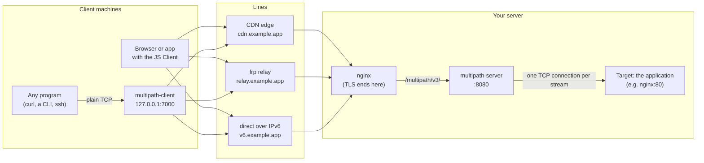
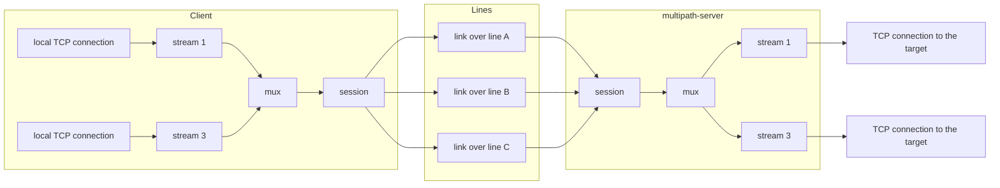
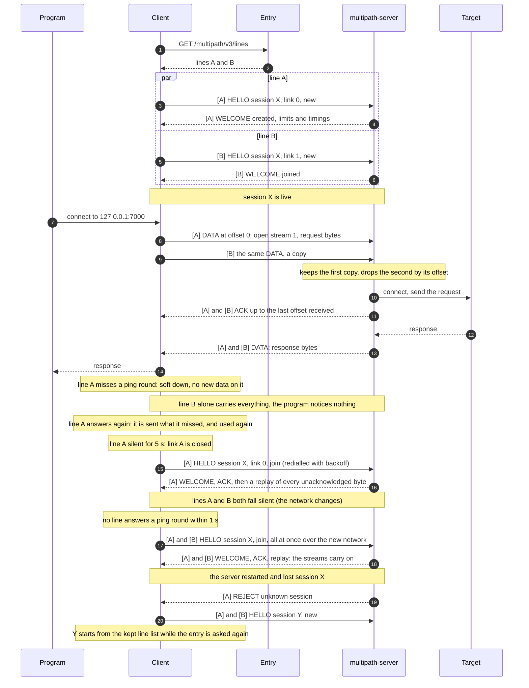
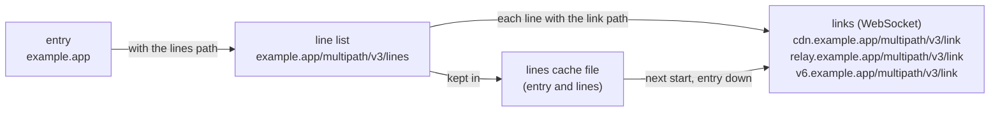

# MultiPath

MultiPath keeps a client connected to one server over several cheap, individually unreliable
network paths at once. Every byte travels on every path; the receiver keeps the first copy. As long
as one path works, the client does not notice that the others stalled or died.

It is two small programs and a library:

- `multipath-server`, which sits beside your application and forwards everything to it;
- `multipath-client`, a local TCP port that any program can use as if it were the application;
- `@micro-teams/multipath`, the same client inside a browser page, a service worker, a React Native
  app or Node.

The wire protocol is specified in [`PROTOCOL.md`](./PROTOCOL.md); this document explains the idea
and how to run it.

## The problem

You run one application server. Your users reach it over networks you do not control: a campus
network that drops long connections, a mobile link that switches towers, a country whose routes to
your host stall for minutes at a time. You can buy one premium path and hope it holds, or you can
offer several ordinary ones:

- a CDN in front of your domain,
- a relay you rent somewhere (an frp tunnel, for example),
- a direct address over IPv6,
- a second domain on a different provider.

Each of these fails now and then, and each fails for its own reasons, at its own times. Taken
together, the chance that all of them fail at the same moment is small. What is missing is a way for
a client to use all of them as one connection, so that a failing path costs nothing as long as
another one works. That is what MultiPath does.

In MultiPath's words, each path is a **line**.

## How it works

### The picture



- Every line is an HTTPS origin that ends at the same `multipath-server` process. The server speaks
  plain HTTP; TLS is done by whatever sits in front of it on each line (the CDN, nginx, the relay's
  TLS endpoint).
- The server forwards every connection to **one** fixed TCP address, its target, configured on its
  command line. Usually the target is the application's own HTTP port, so a request that arrives
  over the lines lands exactly where the same request over plain HTTP would.
- A client is configured with one **entry**, an origin such as `https://example.app`. It asks the
  entry for the **line list** (which lines exist), and then connects over all of them at once.

### The layers



| Layer | What it is | What it guarantees |
|---|---|---|
| **link** | One WebSocket connection over one line. | Nothing on its own: it may stall or die at any moment. |
| **session** | Up to 8 links joined into one ordered byte stream in each direction. Every byte is numbered by its offset and sent on every live link. | Bytes arrive in order, exactly once, as long as one link lives. |
| **mux** | Many streams inside the session, each with its own flow control. | A slow stream does not hold up the others. |
| **stream** | One conversation with the target. | Behaves like a TCP connection: ordered bytes, half-close, reset. |

**One local TCP connection is one stream.** When a program connects to `multipath-client`'s port,
the client opens a stream; the server opens a TCP connection to its target for it, and the two are
joined until either side closes. The program sees an ordinary TCP connection to the application. The
JavaScript client does the same inside the program: each `fetch` and each WebSocket it carries is
one stream.

Nothing in a stream names a destination. Every stream of every session reaches the same target, so
the server can never be used as an open proxy.

### A session, step by step



What happens, in words:

1. **Discovery.** The client fetches the line list from its entry. The list replaces whatever list
   the client had; it is never merged with an older one. The client keeps it (in memory, and on
   disk or in a store if configured), so that the next session can start from it at once even when
   the entry is down.
2. **Handshake.** The client picks a random 16-byte session id and sends HELLO on every line. The
   first line to arrive creates the session; the others join it. WELCOME carries the server's limits
   and the liveness timings the client must use.
3. **Redundant data.** Each side numbers the bytes it sends. A DATA frame carries an offset and a
   piece of bytes and goes out on every live link. The receiver delivers each byte once, in order:
   a copy it already has is dropped, a piece that arrives ahead of a gap waits in a bounded reorder
   buffer.
4. **Acknowledgements.** The receiver acknowledges the offset up to which it has everything. The
   sender keeps every byte until it is acknowledged, and never has more than the session window
   (2 MiB) unacknowledged.
5. **A line is late or dies.** Twice a second the client sends a ping round on all links at once. A
   link that has not answered within 1 s is soft down: no new data goes on it, but it stays
   connected, and when it answers again it is sent what it missed and used again. A link that stays
   silent for 5 s (or four of its round trips, if longer), or whose acknowledgements stop moving, is
   closed and redialled with backoff (200 ms up to 5 s, with jitter) for as long as the session
   lasts. When it joins again, it first receives every byte that is still unacknowledged (the
   replay), so it catches up before carrying new data.
6. **All lines fall silent.** When no link answers a ping round within 1 s, the client dials every
   line again at once into the same session; the old links stay until the new ones replace them.
   The server keeps the session while any of its links is alive (10 s of silence each), so a
   network handover or a short outage costs nothing: the streams resume where they were. Only when
   the server has lost the session (it rejects the join) or no line has answered for the server's
   10 s does the session end, every open stream fail at once, and the client start a new one.
7. **The server goes away.** When the server shuts down it says GOODBYE on every session; when it
   restarted without saying so, it rejects the old session id. Either way the client waits a random
   0 to 2 s before its new session, so the clients of a restarted server do not all return in the
   same instant.

## Guarantees and limits

**What survives.** Any line stalling, dying, reordering or corrupting data (every DATA frame carries
a CRC-32), as long as at least one line works. Lines can come and go any number of times during a
session; a replaced line list adds and removes lines in a running session.

All lines failing at once for less than 10 s, as when a laptop or a phone changes networks: the
client redials every line into the same session and the streams carry on after a pause.

**What does not survive.** A server restart, or every line failing for longer than the server's
10 s. The session ends and open connections fail. A new session starts immediately, but MultiPath
does not resend application requests; retrying is the application's business, exactly as with TCP.

**How fast a dead line is noticed.** The server announces the timings in WELCOME; the defaults are:

| Rule | Default |
|---|---|
| The client sends a ping round on all links | every 0.5 s |
| Client: a link that has not answered a round is soft down (no new data) after | 1 s |
| Client: no link answers a round: every line is redialled into the session after | 1 s |
| Client: a link with no incoming byte is closed after | 5 s, or 4 round trips if longer |
| Server: a link with no incoming byte is closed after | 10 s |
| A link carrying unacknowledged data must see its acknowledgement advance within | 10 s |

A line with jitter, or one TCP retransmission, is only soft down for a moment: its link is kept. A
line whose round trip itself exceeds 1 s is soft down for good and carries data only when no other
line answers.

**What it costs.** Every byte is sent on every line, so with three lines the server sends and
receives up to three times the traffic. A slow line costs less than that: each link writes from its
own queue and skips bytes the other side has already acknowledged, so a slow line only carries what
the peer still lacks, and never holds up the fast ones. Redundancy buys latency and resilience, not
throughput.

**Security model.**

- *One target.* The server forwards to the one address it was started with. A client cannot name
  another destination.
- *Line lists come from the entry only, and replace each other.* A client never accumulates lines
  from older lists or other sources. A list kept across restarts is used only by a client of the
  same entry, and passes the same checks as a fresh one.
- *No downgrade.* An `https` entry accepts only `https` lines. The JavaScript client additionally
  accepts only lines on the entry's site (its host and subdomains, unless configured otherwise).
- *TLS is done by the fronts.* Each line's TLS ends at the CDN, relay or nginx in front of the
  server; the server and its target speak plain TCP on a network you control.
- *Session ids are secrets.* Whoever knows one can attach links to that session; ids are random,
  16 bytes long, and travel only inside the links.

**Resource bounds.** Every server resource is bounded by the number of live TCP connections times a
constant (PROTOCOL.md section 8). A session needs a live link and ends with its last one, so there
are no orphaned sessions. A link costs two goroutines and at most `window + 128 KiB` of queued
bytes; a stream costs one target connection and two goroutines; at most 256 streams and 8 links per
session; a connection that does not finish its handshake in 5 s is closed. Every length, offset and
count received from a client is checked, and a violation closes the link or ends the session.
Limiting connections per address is left to the front proxy.

## Using it

The binaries build with Go 1.24 or later:

```sh
cd go
go build ./cmd/multipath-server
go build ./cmd/multipath-client
```

### 1. Run the server

Write the line list: every public way to reach this server, each an origin with no path.

```json
{"lines": [
  {"id": "cdn", "url": "https://cdn.example.app"},
  {"id": "relay", "url": "https://relay.example.app"},
  {"id": "v6", "url": "https://v6.example.app"}
]}
```

`id` is a short unique name used in logs and status; `url` is `https://` or `http://`, a host and
an optional port, nothing else. A list has 1 to 255 lines (a client uses at most 8, the
`-max-links`); members other than `id` and `url` are ignored. The server refuses to start with an
invalid file, and reads it again on every request, so lines can be added and removed without a
restart (while the file is invalid, the list answers 500 and the reason is logged).

Start the server next to the application:

```sh
./multipath-server -listen :8080 -target 127.0.0.1:80 -lines-file /etc/multipath/lines.json \
    -status 127.0.0.1:9101
```

| Flag | Default | Meaning |
|---|---|---|
| `-target` | (required) | `host:port` every stream is forwarded to. |
| `-lines-file` | (required) | The line list, served at `-lines-path`. |
| `-listen` | `:8080` | Plain HTTP address for links and the line list. |
| `-link-path` | `/multipath/v3/link` | Path of the WebSocket link endpoint. |
| `-lines-path` | `/multipath/v3/lines` | Path of the line list. |
| `-status` | off | Local address serving the live counters as JSON. |
| `-status-every` | `1m` | Interval of the counters log line; `0` turns it off. |
| `-proxy-protocol` | off | Start every target connection with a PROXY protocol v2 header carrying the client's address. |
| `-window` | `2097152` (2 MiB) | Session window: unacknowledged bytes in flight, per direction. |
| `-stream-window` | `262144` (256 KiB) | Credit the server grants each stream, which bounds what it buffers per upload. |
| `-max-streams` | `256` | Open streams per session. |
| `-max-links` | `8` | Links per session. |

The limits are announced to clients in WELCOME; PROTOCOL.md section 7 gives their allowed ranges.

**Put it behind every front.** Each line must reach the server's `-listen` port at the link and
lines paths, with WebSocket upgrades passed through and no buffering. In nginx:

```nginx
map $http_upgrade $connection_upgrade { default upgrade; '' close; }

location /multipath/v3/ {
    proxy_pass http://127.0.0.1:8080;
    proxy_http_version 1.1;
    proxy_set_header Upgrade $http_upgrade;
    proxy_set_header Connection $connection_upgrade;
    proxy_set_header X-Forwarded-For $proxy_add_x_forwarded_for;
    proxy_buffering off;
}
```

A CDN in front of that nginx needs WebSockets enabled for the path; an frp relay forwards a port or
a domain to nginx (or straight to the server, with TLS on the relay). Each line is checked on its
own with two requests:

```sh
curl -fsS https://relay.example.app/multipath/v3/lines        # prints the line list
curl -si -H 'Connection: Upgrade' -H 'Upgrade: websocket' -H 'Sec-WebSocket-Version: 13' \
  -H 'Sec-WebSocket-Key: dGhlIHNhbXBsZSBub25jZQ==' \
  https://relay.example.app/multipath/v3/link | head -1       # HTTP/1.1 101 Switching Protocols
```

**Health.** `-status` serves `{"sessions":…,"links":…,"streams":…,"targets":…,"goroutines":…}` on
a local address (any path, e.g. `curl -s 127.0.0.1:9101`), and the same counters go to the log every
`-status-every`. Keep the status address local: it is not meant for the public.

**The client's address.** The target sees every connection coming from the server. With
`-proxy-protocol`, each target connection starts with a PROXY protocol v2 header carrying the
client's address, taken from the first link's `CF-Connecting-IP`, else the first `X-Forwarded-For`
entry, else the socket peer. Enable it only when the server is reachable solely through fronts that
set these headers, and only towards a target listener that expects the header (in nginx,
`listen 8081 proxy_protocol;` with `set_real_ip_from` the server's address; nginx cannot mix
connections with and without the header on one port).

**Shutdown.** On SIGINT or SIGTERM the server says GOODBYE to every session and exits; clients
start their next session with the next server process.

### 2. Run `multipath-client`

```sh
./multipath-client -entry https://example.app -listen 127.0.0.1:7000 \
    -status 127.0.0.1:7001 -lines-cache ~/.cache/multipath/lines.json
```

Now point any program at `127.0.0.1:7000` as if it were the server's target. If the target is an
HTTP server, speak plain HTTP and name the site in `Host` (the lines carry the TLS):

```sh
curl -H 'Host: example.app' http://127.0.0.1:7000/api/items
```

The same works for any TCP protocol the target speaks: with an SSH server as the target,
`ssh -p 7000 127.0.0.1` is an SSH session that survives lines dying. In Go, an `http.Client` whose
transport dials `127.0.0.1:7000` for every request sends all of its traffic over the lines.

| Flag | Default | Meaning |
|---|---|---|
| `-entry` | (required) | Origin the line list is fetched from, such as `https://example.app`. |
| `-listen` | `127.0.0.1:7000` | Local address programs connect to. |
| `-status` | off | Local address serving `GET /status` as JSON. |
| `-lines-cache` | off (memory only) | File that keeps the last line list across restarts. |
| `-lines-path` | `/multipath/v3/lines` | Path of the line list on the entry. |
| `-link-path` | `/multipath/v3/link` | Path of the link endpoint on every line. |
| `-proxy` | from the environment | `http://` proxy for the lines and the line list. Without it, `HTTPS_PROXY`, `HTTP_PROXY` and `NO_PROXY` apply. |
| `-refresh` | `10m` | Interval of line list refreshes. |
| `-wait` | `10s` | How long a local connection waits for a live session before it is closed. |

How the addresses fit together:



- The entry is asked for the list at `-entry` + `-lines-path`. The entry is usually one of the lines
  itself (the public origin), but it does not have to be.
- Every line in the list is dialled at its `url` + `-link-path`, as `wss://` for `https` lines and
  `ws://` for `http` lines. The paths must match the server's `-link-path` and `-lines-path`.
- The last list the entry served is kept in memory and, with `-lines-cache`, in the file as
  `{"entry": "...", "lines": [...]}`. A new session dials the kept list at once while the entry is
  asked again, so an entry that is down or slow does not stop lines that work; the client logs that
  it runs on the kept list and asks the entry again with backoff (1 s to 30 s) until it answers. Its
  answer replaces the kept list. A file written for another entry is ignored. Only a client that has
  never had a list waits for the entry.
- The list is fetched again for every new session and every `-refresh`. Lines added to it are
  dialled; links of lines removed from it are closed once a line still in the list is up.

On SIGINT or SIGTERM the client says GOODBYE, so the server releases the session at once.

### 3. Use the JavaScript client

`js/` is the npm package `@micro-teams/multipath`, published to GitHub Packages from release tags
(add `@micro-teams:registry=https://npm.pkg.github.com` to `.npmrc`). It is the same client as
`multipath-client`, built into the program instead of being a local port: one `Client` holds one
session, and every request it sends is a stream of that session.

**In a page:**

```ts
import { Client } from '@micro-teams/multipath';

const client = new Client({
  entry: location.origin, // where the line list comes from
  store: {
    // keeps the last list across reloads, so the next visit can start without the entry
    load: async () => JSON.parse(localStorage.getItem('multipath-lines') ?? 'null'),
    save: async (stored) => localStorage.setItem('multipath-lines', JSON.stringify(stored)),
  },
  onEvent: (e) => console.log(e), // line up or down, session start or end
});

const res = await client.fetch('/api/items'); // one HTTP/1.1 exchange on a fresh stream
const items = await res.json();
const ws = await client.openWebSocket('/updates', ['v1']); // a WebSocket on a fresh stream
console.log(client.stats()); // session, lines and streams, as multipath-client's /status
```

**In a service worker**, the line router carries the requests the browser makes for the page
(the document, scripts, fonts, images), and falls back to the network when the lines cannot:

```ts
import { cacheLineStore, createLineRouter } from '@micro-teams/multipath';

const router = createLineRouter({
  entry: self.location.origin,
  store: cacheLineStore('lines', new URL('__lines', self.location.href).href),
  fallbackAfterMs: 3000, // no live session by then: requests go to the network
  requestTimeoutMs: 10000, // a GET without a response head by then goes to the network
});
self.addEventListener('fetch', (e) => e.respondWith(router.fetch(e.request)));
```

A page and its service worker each hold their own client and their own session: the worker carries
what the browser fetches, the page what it fetches itself.

`Client` options:

| Option | Default | Meaning |
|---|---|---|
| `entry` | (required) | Origin the line list is fetched from. An `https` entry accepts only `https` lines. |
| `site` | the entry's host | Every line must be on this host or a subdomain of it; `null` allows any host. |
| `store` | none | A `LineStore` (`load()` and `save(stored)` of `{entry, lines}`) that keeps the last list across restarts. |
| `linkPath`, `linesPath` | `/multipath/v3/link`, `/multipath/v3/lines` | Paths on the lines and on the entry. |
| `refreshMs` | 10 minutes | Interval of line list refreshes. |
| `waitMs` | 10 s | How long a request waits for a live session before it fails. |
| `recvWindow` | 1 MiB | Receive credit of each stream. |
| `compression` | `true` | Ask for gzip and decode it with `DecompressionStream`. |
| `buffered` | `false` | Read each response whole before returning it, for platforms whose `Response` cannot stream. |
| `onEvent` | none | Told about every line up or down, session start or end, and router fallback. |
| `log` | `console.info` | One line per event. |

`Client` methods: `fetch(input, init)` resolves when the response head arrives and streams the body;
the stream is released as soon as the body is complete or abandoned, and an abort signal resets it.
`openWebSocket(path, protocols)` opens a WebSocket to the entry's host. `live(timeoutMs)` resolves
whether a session became live in time. `stats()` is a snapshot of the session, lines and streams.
`close()` says GOODBYE and stops.

`createLineRouter` takes the `Client` options plus:

| Option | Default | Meaning |
|---|---|---|
| `fallbackAfterMs` | 3000 | Without a live session this long after the router starts, requests go to the network. |
| `requestTimeoutMs` | 10000 | A GET or HEAD without a response head this long after it was sent goes to the network. |
| `fallback` | the platform's `fetch` | What "the network" is. |
| `integrity` | none | Rules for static files that carry a hash of their content in their name (below). |

Every fallback is logged and reported as a `fallback` event with its reason. A GET or HEAD that
fails over the lines is sent to the network; any other method is sent at most once, over the lines.

Integrity rules make sure a cache never keeps a corrupted static file. A rule is a pattern with one
capture group, the hex hash in the file's name (a prefix of its digest), and an algorithm (`MD5`,
`SHA-1`, `SHA-256`, `SHA-384` or `SHA-512`). A matching file's body streams through at once except
its last piece, which is released only once the digest matches; on a mismatch the body fails and
that URL goes to the network from then on.

```ts
integrity: [{ pattern: /\/static\/js\/[^/]+-([0-9a-f]{32})\.js$/, algorithm: 'MD5' }],
```

**Platforms.**

- Browsers and service workers need nothing special. Browsers throttle timers in background tabs; a
  session that misses its pings there redials its lines into itself, as after a network change.
- React Native: pass `compression: false` and `buffered: true` (there is no `DecompressionStream`,
  and its `Response` cannot take a stream); the constructor refuses the defaults there rather than
  degrade quietly.
- Node 22 and later: the built-in `WebSocket` and `fetch` are used.

With `compression`, the target decides what to compress: for nginx, `gzip on` with `gzip_types` for
scripts, stylesheets, JSON and fonts. Over a slow line a first page load shrinks to about a quarter.

### Adding a line

1. Make the new path reach the server's link and lines paths: a DNS name on a CDN, a relay, a port.
   For TLS, the front of that path terminates it.
2. Check it on its own with the two `curl` commands above: the list is printed, and the link
   endpoint answers `101 Switching Protocols`.
3. Add it to the lines file: `{"id": "new", "url": "https://new.example.app"}`. No restart: the
   server reads the file on every request.
4. Clients pick it up with their next session or refresh (10 minutes by default) and dial it in the
   running session. Removing a line works the same way: clients close its links once another line
   is up.

Browsers accept only lines on the entry's site, so a new line for a web client is a subdomain of the
entry's host (or `site` is set to a parent domain).

## Observability

Both processes log one line per event, naming the session by the first 8 hex digits of its id:
session start (with the peer's implementation and the client address), every link up and down with
the reason, every link going soft down and answering again, every silent session and its redial, every REJECT with the reason, stream failures, session end with the reason, and every
limit violation. Nothing is retried or given up silently.

- The server: the `-status` counters and the periodic `status:` log line (sessions, links, streams,
  target connections, goroutines).
- The client: `GET /status` on its `-status` address (or `client.stats()` in JavaScript) gives the
  session (id, state, age, bytes sent, unacknowledged and received), every line (state, whether it
  is soft down, its smoothed round trip `rttMs`, milliseconds since its last byte, bytes in and out,
  reconnects, last reason), every open stream (bytes in and out, buffered bytes, send credit), the
  number of sessions started and why the previous one ended. The line that is up, not soft down, and
  has the smallest `rttMs` is the quickest way to the server at the moment, for a program that wants
  to fetch something large over one line instead of over all of them.

## The repository

| Path | What it is |
|---|---|
| [`PROTOCOL.md`](./PROTOCOL.md) | The normative wire protocol, version 3. |
| `go/cmd/multipath-server`, `go/cmd/multipath-client` | The two programs. |
| `go/protocol` | Frames, limits and the line list. |
| `go/link` | WebSocket links and HTTP proxies. |
| `go/session` | The redundant byte stream: offsets, acknowledgements, replay, liveness. |
| `go/mux` | Streams with credit inside a session. |
| `go/server`, `go/client` | The server and client as Go packages, used by the programs. |
| `js/` | `@micro-teams/multipath`, the JavaScript client and the service worker's line router. |
| `spec/vectors/` | The encoding of every frame, shared by all implementations' tests. |
| `conformance/` | A fault-injecting proxy and scenarios that run the real programs through broken lines and attacks. |

Tests:

```sh
cd go && go vet ./... && go test -race ./...           # Go unit tests
cd js && npm ci && npm test                            # JavaScript unit tests, with the shared vectors
conformance/run.sh                                     # the real programs through faults
MP_BROWSER=1 conformance/run.sh                        # also in Chromium (npx playwright install chromium in js/)
```

The conformance suite builds both programs and the JavaScript package, then runs every scenario
with production timeouts, first with the Go client and then with the JavaScript client in Node:
impaired lines, a stalled line, links cut hundreds of times, server restarts, a network switch, a
long session, a slow distant line, and attacks. It prints the measured recovery times and resource
counts at the end. CI also runs `npm run lint`, `npm run format:check` and `npm run build` in
`js/`.

A change to the wire changes `PROTOCOL.md`, `spec/vectors/frames.json` and the code together;
`go test ./protocol -run Vectors -update` rewrites the vectors' hex from their fields. The
repository's rules are in [`AGENTS.md`](./AGENTS.md).

## Versions and releases

The protocol version (3) and the release version (in `VERSION`) are separate. Protocol version 3
is served on its own paths (`/multipath/v3/...`), so a server of another protocol version can run
beside it during a migration; new frame types can be added without a version change, because
unknown ones are skipped. What changed in each release is in [`CHANGELOG.md`](./CHANGELOG.md).

`scripts/version.sh` sets the version in `VERSION`, the Go and JavaScript implementation strings and
`js/package.json`, and its header describes how a release is tagged. CI refuses a tag that disagrees
with any of them and publishes the npm package from the tag; nothing is published from a branch. The
Go module needs no publishing: `go get github.com/micro-teams/multipath/go@go/v<version>` resolves
the tag.

## License

MIT, see [LICENSE](./LICENSE).
